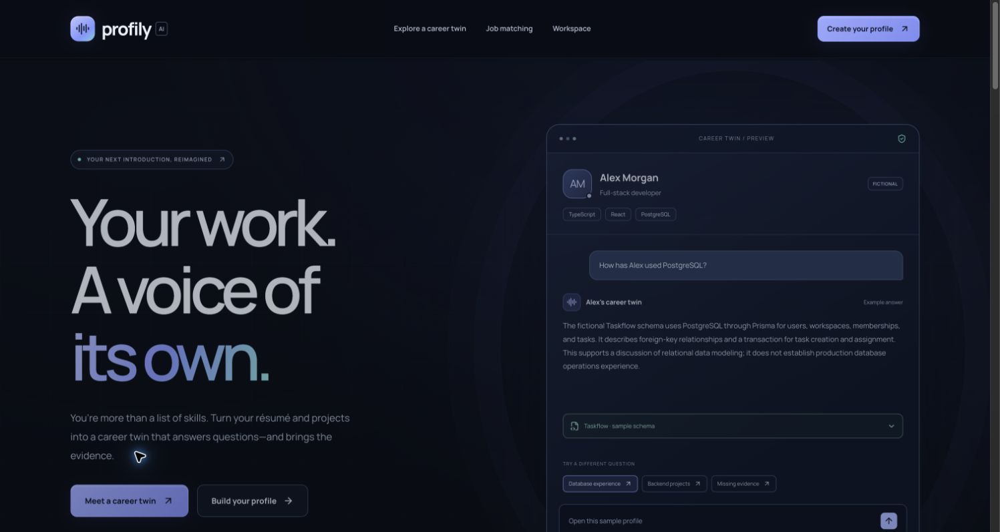
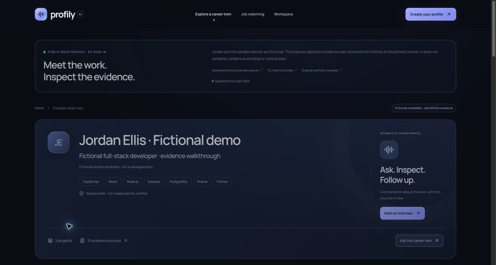

# Profily AI

[Live application](https://profily-ai.vercel.app) · [No-sign-in judge demo](https://profily-ai.vercel.app/profile/judge) · [Public repository](https://github.com/Lakshyalamba/profily-ai)

An interactive professional profile for developers. Ask a candidate’s AI career representative about their work, inspect the supporting source, and save an interview brief. Profily distinguishes self-reported experience from observed repository contents and says when evidence is insufficient.

## The problem

A static resume rarely explains what a developer personally built, which technical decisions they made, or what supports a listed skill. Recruiters need context and follow-up questions; developers need a way to explain their work without inventing experience. Profily makes that conversation possible using deliberately supplied information.

Unlike a traditional portfolio, this profile answers contextual questions. Unlike a generic resume chatbot, factual answers require source references, exact quote validation, and a separate grounding review. Repository contents establish observations about code, not personal authorship. The system provides qualitative evidence comparisons, not candidate rankings or hiring recommendations. No recruiter outcomes or performance improvements have been measured.

The application is deployed on Vercel with durable Redis storage, distributed write protection, shared AI quotas and a public judge walkthrough. The interface now uses a shared dark design system, self-hosted Manrope typography, responsive workspace navigation and Motion for React. Backend APIs, evidence validation, storage and ownership mechanisms are unchanged by the redesign.

## Main features

- **Resume review:** text-based PDF extraction, Gemini structuring, Zod validation, editable professional details and projects, explicit private save. Saved details load into the editor, repositories can be removed individually from the draft, and changed source selections require review. Import before editing; an import replaces the unsaved form.
- **Repository evidence:** public GitHub metadata, pinned commit, sampled tree, eligible README, manifests and selected source files. Exact excerpts, coverage warnings, and cited AI observations remain inspectable. If Gemini analysis fails, retrieved evidence is labeled accordingly.
- **Public links:** `/publish` previews approved details and lets you select repository excerpts. Raw resume pages are excluded. Published snapshots are separate from private edits, expire after seven days, and can be replaced or unpublished by the creator’s browser. Guest recruiters need no creator cookie.
- **Grounded conversation:** recent context, bounded relevance-ranked evidence, server-owned quote spans, exact citation checks and a separate Gemini grounding review. Unsupported or rejected claims produce an explicit uncertainty or withheld-answer state.
- **Browser voice:** start/stop, listening/processing/speaking states, mute, playback interruption, and text fallback. This is turn-based browser speech recognition and speech synthesis, not an audio-streaming Gemini integration. Profily does not store audio.
- **Recruiter interviews:** consented private text transcripts, follow-ups using recorded history, retry-safe turns, frozen evidence, automatic deterministic briefs, a follow-up checklist derived from unresolved recorded questions, and downloadable PDFs containing sources and uncertainty.
- **Job comparison and analytics:** supported, partial, or not-established requirements, quoted job requirements and citations; optional saved reports. Dashboard activity is calculated from recorded sessions, with no fabricated statistics or proficiency scores.
- **Judge demonstration:** `/profile/judge` combines a clearly fictional resume with real Express repository observations pinned to a commit. It uses actual Gemini and requires no sign-in. Repository presence does not establish candidate authorship. `/profile/demo` remains the original entirely synthetic example; its optional scripted fallback is visibly labeled.

## Technology stack and architecture

Next.js App Router 16, React 19, TypeScript, Tailwind CSS 4, Motion for React, self-hosted Manrope (SIL Open Font License), Lucide icons, owned reusable components using Radix Slot, Zod, Gemini REST `generateContent`, GitHub REST, unpdf, pdf-lib/fontkit, and browser Web Speech APIs. See `package.json` and its lockfile for exact versions. No client-side Gemini key or Wispr Flow SDK is used.

```text
Browser: profile/editor/chat/interview/match/dashboard
  -> same-origin Next.js Node route handlers
     -> Zod input validation + size/origin/rate limits
     -> private cookie workspace / separately approved public snapshot
     -> PDF child process OR bounded public GitHub retrieval
     -> relevant contiguous evidence windows -> Gemini structured output
     -> exact citations + grounding audit -> answer / explicit uncertainty
     -> consented activity store -> deterministic brief -> PDF
```

On Vercel, private profiles, public snapshots, repository cache and recruiter activity are stored in Upstash Redis over authenticated HTTPS. Distributed, renewed leases and fenced mutations protect updates across instances; Lua applies shared AI quotas atomically. Missing durable configuration fails closed. Locally, JSON files in sibling directories under the data parent remain available for a single Node process. Private cookie ownership is not account authentication. Public snapshots omit raw resume pages, owner identifiers and repository analyses that could reference excluded excerpts. Public evidence is intentionally readable by anyone with the link. Interview transcripts remain private to the recruiter’s cookie.

Evidence retrieval selects up to 24 contiguous source windows, at most 6,000 characters each and 40,000 excerpt characters total. Recent casual context is limited to 20 messages; interviews retain up to 30 questions. Retrieval is bounded and can omit relevant evidence; “not established” never proves an ability is absent.

## Installation and running

Requires **Node.js 24.x** and npm. From the project directory:

```sh
npm ci
# First setup only; preserve an existing .env.local:
cp .env.example .env.local
# Set GEMINI_API_KEY in .env.local, then:
npm run dev
```

Open [the local application](http://127.0.0.1:3000) and [the judge demo](http://127.0.0.1:3000/profile/judge). The separately deployed website is linked above.

Production on this computer:

```sh
npm run build
npm start
```

`npm start` loads runtime `.env.local`, copies the generated static assets, keeps the data path rooted in the project, and starts the traced Node server on loopback by default. For externally reachable hosting use the standalone Node server behind HTTPS as described in [deployment instructions](docs/DEPLOYMENT.md). Keep `.env.local`, `.data`, and generated build files out of version control and submission archives. Never paste credentials into chat or a README.

## Environment variables

| Variable                               | Required                                    | Purpose                                                                                                                                              |
| -------------------------------------- | ------------------------------------------- | ---------------------------------------------------------------------------------------------------------------------------------------------------- |
| `GEMINI_API_KEY`                       | For live AI                                 | Server-only Gemini credential; no `NEXT_PUBLIC_` prefix.                                                                                             |
| `GEMINI_MODEL`                         | Optional                                    | Structured-output capable model available to your key; default `gemini-3.1-flash-lite`. Availability/quota depend on the provider account.           |
| `PROFILY_DATA_DIR`                     | Optional locally; persistent path on a host | Private profile directory, default `.data/profiles`; persist its **parent** for sibling activity, public profiles and cache.                         |
| `GITHUB_TOKEN`                         | Optional                                    | Server-only token for public GitHub API quota. Keep permissions minimal; private repositories remain rejected.                                       |
| `PROFILY_PUBLIC_BASE_URL`              | Required behind a self-hosted HTTPS proxy   | Canonical external origin, e.g. `https://profily.example.com`, without a path. Used for origin validation and secure cookies. Leave blank locally.   |
| `KV_REST_API_URL`, `KV_REST_API_TOKEN` | Required on Vercel                          | Upstash HTTPS REST URL and write token, supplied by the native integration. Alternative names: `UPSTASH_REDIS_REST_URL`, `UPSTASH_REDIS_REST_TOKEN`. |
| `PROFILY_STORAGE_PREFIX`               | Recommended for Redis                       | Isolates records, locks, cache and quotas; use separate production and preview namespaces.                                                           |
| `PORT`, `HOSTNAME`                     | Standalone runtime                          | Listener configuration; use `HOSTNAME=0.0.0.0` inside a container.                                                                                   |
| `PROFILY_TEST_URL`                     | Optional test setting                       | Running server URL for HTTP verification; default `http://127.0.0.1:3000`.                                                                           |
| `PROFILY_TEST_LIVE`                    | Optional test setting                       | Set `1` to add an actual Gemini public-chat request to `test:public`.                                                                                |

GitHub uses anonymous public access by default. An optional server-only `GITHUB_TOKEN` can provide authenticated public API quota; it is sent only in a header to api.github.com, with redirects rejected. Private repository analysis remains unsupported. Anonymous or authenticated quota can still block imports. There is no Wispr Flow API variable.

## Key routes and project structure

| Route                     | Purpose                                                                     |
| ------------------------- | --------------------------------------------------------------------------- |
| `/`                       | Product overview and fictional preview                                      |
| `/create`                 | Import, edit, review and save private profile                               |
| `/profile/private`        | Creator-cookie private career twin                                          |
| `/publish`                | Approve, update or revoke a public snapshot                                 |
| `/p/[id]`                 | Guest-accessible published profile                                          |
| `/profile/judge`          | Fictional resume + pinned real GitHub evidence; no sign-in                  |
| `/profile/demo`           | Original fictional public demonstration                                     |
| `/interview?profile=demo` | Start consented interview; also accepts `judge`, `private` or `public-<id>` |
| `/interview/[id]`         | Recruiter-cookie transcript, brief and PDF                                  |
| `/match?profile=demo`     | Job comparison; same profile references supported                           |
| `/analytics`              | This browser’s recorded recruiter activity                                  |
| `/api/status`             | Configuration presence/model status; never returns the key                  |

```text
src/
  app/                  Pages, styles and Node API routes
    api/                profile, resume, repositories, chat, match,
                        publish, public/[id], interviews, analytics
  components/           Editor, profile, publishing, shared conversation,
                        voice controls, interviews, summaries, dashboard
  styles/               Shared tokens, shell, landing, workspace, profile,
                        conversation and reporting styles
  hooks/use-voice.ts     React adapter to browser voice controller
  lib/ai/               Career responses and explicitly scripted demo
  lib/server/           Gemini, grounding, retrieval, ingestion, private /
                        public / activity stores, interview service and PDF
  lib/voice/            Testable turn-based speech controller
  types/                Zod contracts and derived TypeScript types
  data/demo.ts          Original labeled synthetic candidate
  data/judge-profile.json Fictional resume + pinned real repository snapshot
scripts/                Isolated PDF worker and live workflow checks
tests/                  Automated tests and synthetic resume fixture
assets/fonts/           Licensed PDF fonts
assets/webfonts/manrope/ Licensed self-hosted interface font
vercel.json             Vercel Node deployment and region
.github/workflows/ci.yml Node 24 checks on push / pull request
Dockerfile, compose.yaml, .dockerignore
.env.example            Empty credential template
README.md, docs/        Setup, deployment, demo script and verification
```

## Quality checks

```sh
npm run typecheck
npm run lint
npm test
npm run build
# Running production server + configured Gemini; these use synthetic people:
npm run test:live        # PDF + real expressjs/express + private chat/match
npm run test:interview   # Actual Gemini, history, brief, PDF, job report, metrics
npm run test:public      # Consent, independent guest, snapshot isolation, revocation
npm run test:routes      # Main pages, internal links/assets and empty anchors
PROFILY_TEST_LIVE=1 npm run test:public
```

Live checks consume provider quota. They use their own cookie and clean up their temporary records. Tests report provider errors and never substitute a scripted result for successful live verification. See [UI redesign verification](docs/UI_REDESIGN.md), [final refinement verification](docs/FINAL_REFINEMENT.md) and [Phase 6 verification](docs/VERIFICATION-PHASE-6.md) for actual outcomes and remaining manual checks, and [the two-minute demo script](docs/DEMO_SCRIPT.md) for exact screens and narration.

## Development with Codex and Wispr Flow

The project owner reports using **Wispr Flow to dictate development instructions into Codex**. Codex was used for implementation, code review, debugging, documentation, and checks. Dictation supported the development workflow by turning spoken product requirements into text prompts. This repository does not record dictation telemetry or establish a measured productivity improvement.

**Wispr Flow is not integrated into the running application through an API or SDK.** Runtime microphone transcription and spoken answers use browser SpeechRecognition/webkitSpeechRecognition and speechSynthesis. Describe those separately in the submission: “Built with Codex, with development prompts dictated using Wispr Flow.” Do not claim a direct Wispr Flow application integration.

## Known limitations

- **Hosting:** Vercel requires the configured durable Redis service; never use its ephemeral filesystem for records. The optional local filesystem backend requires a single Node process and persistent disk. Edge/Workers and static export are unsupported. The free database and Gemini have provider quotas; no uptime guarantee is claimed. Remote records are capped at 3 MB each, so a large workspace or transcript collection can reach capacity before its item-count limit.
- **No accounts or recovery:** losing the cookie loses private workspace, transcript and publication-management access. Cookies and publications last seven days; Redis record TTLs are seven days (repository cache: 30 minutes); filesystem expiry is lazy. The static fictional judge snapshot is bundled with the application and is separate from expiring user publications. Backups and encryption at rest belong to host operations.
- **Public sharing:** review approved fields for personal details. Anyone with a link can read it. Unpublishing revokes the page/API, not already saved recruiter snapshots, screenshots or PDFs. Raw resume pages cannot be published; relevant details must be reviewed into fields. Repository summaries are omitted from published snapshots to avoid references to excluded evidence.
- **Ingestion:** PDF limit 4 MB / 10 pages; no OCR, encrypted-PDF support or private GitHub repositories. GitHub inspection is sampled, caps file sizes, and may use a clearly labeled 30-minute cache. It is not a full repository or security audit. GitHub rate limits can block fresh imports.
- **AI quotas:** the app permits 12 AI requests per browser session per minute and 120 across the deployment per hour, shared across AI features. Gemini applies separate account/model quotas; the app cannot guarantee provider availability. A normal two-minute walkthrough needs far fewer app requests, but repeated rehearsals and other visitors consume the shared budget.
- **AI:** Gemini needs an available model, network and quota. Exact quotes and a semantic review reduce unsupported answers but cannot guarantee correctness. Conservative checks can withhold useful answers. Transient gateway/network failures retry once within the same 55-second provider-call deadline; quota, authentication, blocked content and invalid model output are not automatically retried. Vercel AI routes allow up to 300 seconds; the client timeout is 290 seconds. Normal responses can still vary with provider latency and grounding review. Model responses arrive after validation, not token-streamed. Never present repository presence as candidate authorship.
- **Voice:** English recognition (`en-US`), browser/provider-dependent, secure context or localhost needed. Speech may be processed remotely by the browser’s provider. Browser driver construction, playback and cancellation failures leave text usable. Physical speech-to-answer round-trip remains dependent on target browser permissions and service availability; local checks encountered a microphone-permission timeout and, in earlier testing, a speech-service network error. Text remains functional.
- **Reports:** briefs compile existing checked answers rather than independently verifying candidates; skill counts are keyword mentions, not proficiency. PDFs use bundled font coverage and show unsupported characters as `[U+XXXX]`. No audio recording is provided; consented text transcripts and PDF export record the answers.
- **Demo:** all Alex Morgan and Jordan Ellis candidate information and test resumes are synthetic; the judge profile clearly distinguishes real Express repository observations. No users, testimonials, hiring outcomes, accuracy percentages or speed improvements are claimed.

## Screenshots and actual sample result





[Before redesign](docs/ui-redesign/before-judge-desktop.jpg) · [Mobile judge profile](docs/ui-redesign/live-judge-mobile.jpg)

[Final mobile job comparison](docs/refinement/job-result-mobile.jpg) · [Final desktop comparison](docs/refinement/job-result-desktop.jpg)

[Mobile judge walkthrough](docs/phase-six/deployed-judge-mobile.jpg) · [Actual deployed interview PDF, fictional candidate](docs/phase-six/judge-interview.pdf)

## Deployment and submission

The application is deployed at **https://profily-ai.vercel.app**. See [deployment instructions](docs/DEPLOYMENT.md), [verification evidence](docs/VERIFICATION-PHASE-6.md), [two-minute recording script](docs/DEMO_SCRIPT.md), [submission description](docs/SUBMISSION_DESCRIPTION.md), and [submission checklist](docs/SUBMISSION_CHECKLIST.md), and [final demonstration checklist](docs/FINAL_DEMO_CHECKLIST.md). A deployed app is not a submitted hackathon entry. The owner must record the video, supply a genuine Wispr Insights usage card and review the submission before sending it.
